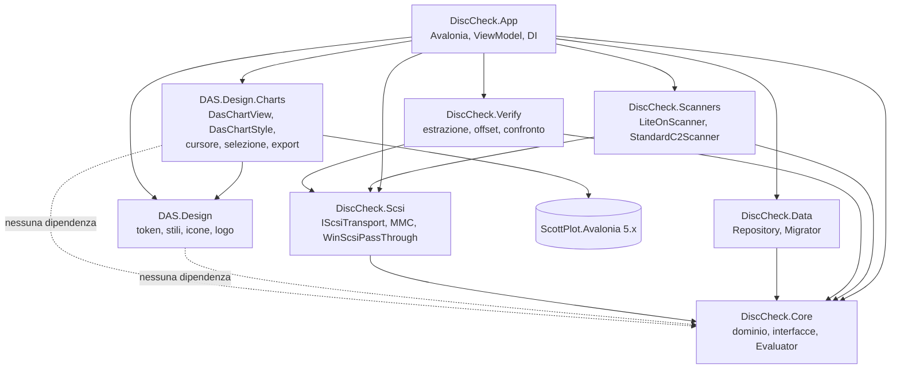
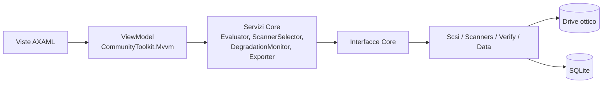
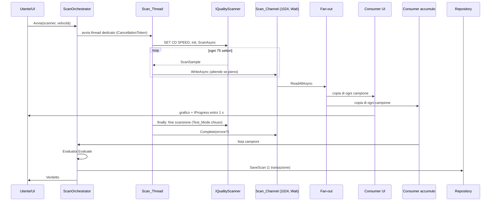
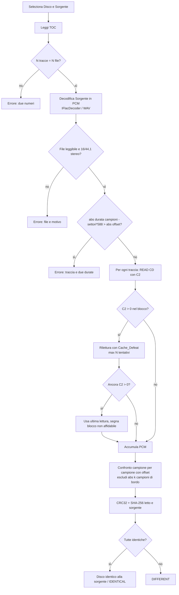
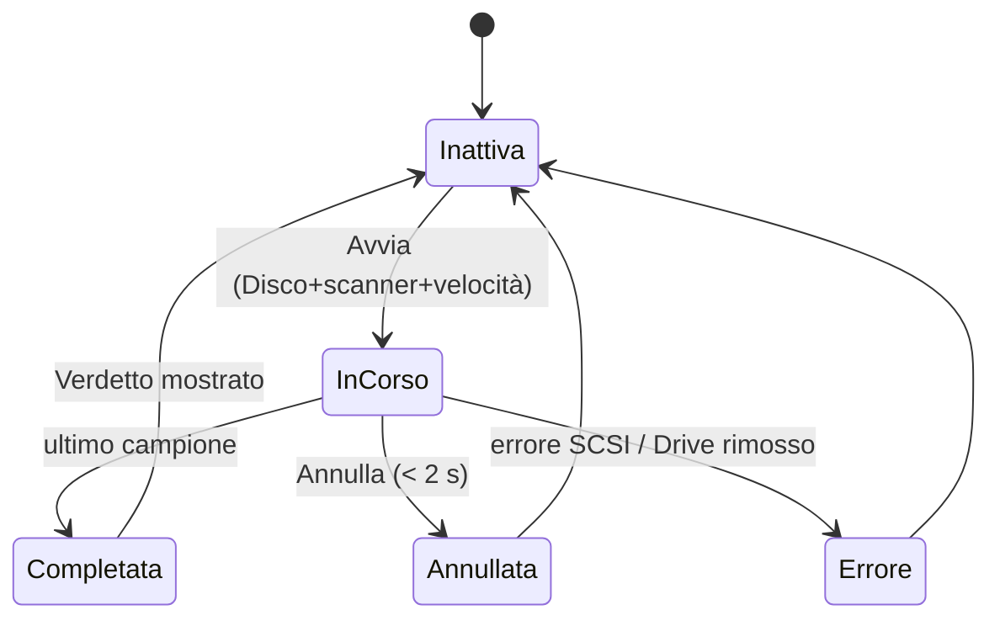
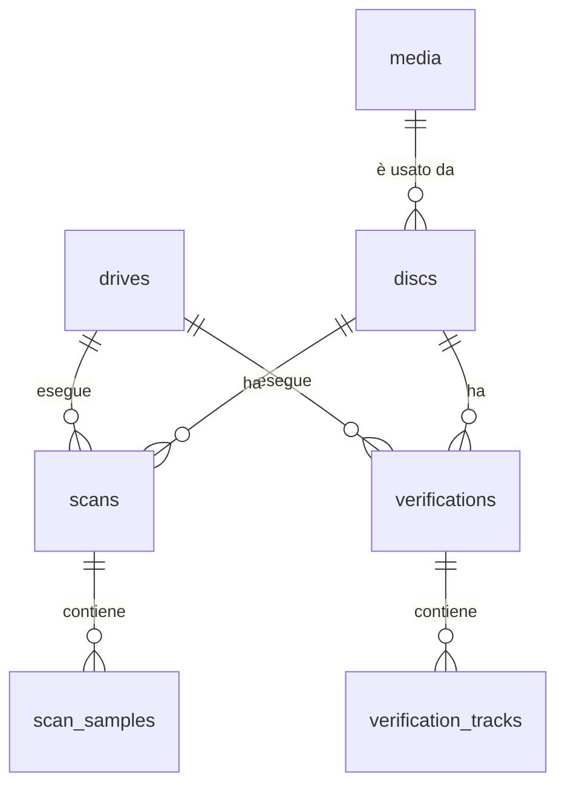

# Documento di Design: DiscCheck

## Overview

DiscCheck è un'applicazione desktop Windows 10/11 x64 (C# 15, .NET 11, Avalonia 11) per il controllo qualità dei CD audio masterizzati. Offre tre funzioni:

1. **Verifica bit-perfect**: estrae l'audio dal Disco con READ CD, lo confronta campione per campione con la Sorgente (FLAC/WAV 16 bit / 44,1 kHz) applicando l'offset di lettura.
2. **Scansione di qualità**: misura C1/C2/CU tramite `LiteOnScanner` (comandi vendor portati da QPxTool) o `StandardC2Scanner` (READ CD con puntatori C2), produce un Verdetto OK/WARN/KO.
3. **Archivio**: salva scansioni e verifiche in SQLite, con storico, confronto, trend di degrado e promemoria di ricontrollo.

Lo stile grafico è fornito da `DAS.Design`, libreria Avalonia indipendente da DiscCheck e riusabile da altre applicazioni DAS. Lo stile e l'interattività dei grafici (cursore, selezione, soglie, evidenziazione errori, export PNG/SVG) sono forniti da `DAS.Design.Charts`, libreria separata che dipende solo da `DAS.Design` e ScottPlot.Avalonia 5.x; tutte le viste con un grafico (Scansione, Storico, Confronto, Archivio/Degrado) usano esclusivamente il controllo `DasChartView`.

### Decisioni di design principali

| # | Decisione | Motivazione |
|---|-----------|-------------|
| 1 | Tutto l'hardware passa da `IScsiTransport` (Req. 1.6, 24.4) | Testabilità con `FakeScsiTransport`, trasporto Linux/macOS (SG_IO) aggiungibile in v2 senza toccare Core/App. |
| 2 | Core privo di dipendenze da Scsi/Data/Avalonia: definisce interfacce (`IQualityScanner`, `IScanRepository`, `IFlacDecoder`, `ISettingsStore`) | I ViewModel orchestrano soltanto (Req. 1.7); il decoder FLAC (D1) è sostituibile (Req. 25.9). |
| 3 | Logica di dominio come funzioni pure nel Core (Evaluator, conteggio bit C2, `toc_hash`, offset, trend, CSV) | Rende le proprietà verificabili con property-based testing. |
| 4 | Pipeline producer/consumer con `Channel<ScanSample>` bounded (1.024, `Wait`) e dispatcher *fan-out* verso 2 consumer | Nessuna perdita né riordino (Req. 9). Un `Channel` consegna ogni elemento a un solo lettore, quindi serve un fan-out. |
| 5 | Dapper + Microsoft.Data.Sqlite, migrazioni SQL versionate, niente EF | Richiesto dal Req. 16.7. Inserimento di ~4.800 campioni in una transazione. |
| 6 | Chiusura del Test_Mode in `finally` per ogni scansione vendor | Evita Drive bloccati in Test_Mode (Req. 8.6, 23.8). |
| 7 | Temi/colori solo tramite Design_Token `Das.*` | Cambio tema senza modificare le viste (Req. 22.7, 35). |
| 8 | Progetto separato `DAS.Design.Charts` con `DasChartView` come unico modo di mostrare un grafico | `DAS.Design` resta privo di ScottPlot (Req. 28.3); stile e interattività sono scritti una volta e riusabili da ogni app DAS (Req. 38.15, 38.16). |
| 9 | Logica di cursore, selezione, formattazione tick, soglie ed evidenziazione come funzioni pure in `DAS.Design.Charts`, su tipi propri (`ChartSample`, `ChartSeries`) | La libreria non può referenziare `ScanSample` di Core (nessun riferimento a `DiscCheck.*`); l'App mappa i propri campioni. Le funzioni sono testabili senza UI (Req. 37.13). |
| 10 | Configurazione di build a livello di repository: `global.json` nella radice fissa l'SDK 11.0.x con `rollForward` = `latestFeature`; `Directory.Build.props` imposta `TargetFramework` `net11.0`, `Nullable` abilitato e lascia `LangVersion` al valore predefinito (C# 15). CI e release usano la stessa versione major dell'SDK di `global.json`. Nessuna funzionalità preview o sperimentale. | .NET 11 è una release STS (GA 10 novembre 2026, supporto fino a novembre 2028): build riproducibili tra sviluppo, CI e release e nessun passaggio accidentale a un SDK diverso o in anteprima. .NET 11 è supportato fino a novembre 2028 (STS con 24 mesi di supporto, stessa scadenza di .NET 10 LTS); pianificare l'aggiornamento alla release successiva entro quella data (Req. 1.2, 1.11-1.13). |

### Ricerca e fonti

- **IOCTL_SCSI_PASS_THROUGH_DIRECT** (0x4D014): richiede buffer allineato secondo `AlignmentMask` di `IOCTL_SCSI_GET_CAPABILITIES`. La struttura `SCSI_PASS_THROUGH_DIRECT` ha `DataBuffer` come puntatore; il sense buffer segue la struttura nello stesso blocco (struttura "with buffers"). Documentazione Microsoft Windows Driver Kit.
- **READ CD (0xBE)**: byte 1 = tipo settore atteso (0x04 = CD-DA), byte 9 = flag di campo (0x12 = user data + C2 pointers 294 byte; 0x14 = user data + C2 + block error byte, 296 byte). Standard T10 MMC.
- **System.Threading.Channels**: `BoundedChannelOptions` con `FullMode=Wait` applica backpressure al producer; `SingleReader/SingleWriter` ottimizzano l'accesso. Un messaggio è letto da un solo consumer, quindi il fan-out è implementato esplicitamente.
- **QPxTool** (fork speed47, GPL-2.0): `plugins/liteon/qscan_cmd.cpp` e `qscan_plugin.cpp` sono l'unica fonte dei CDB vendor. I byte dei CDB non sono riprodotti in questo documento; vanno estratti dal sorgente in implementazione (Req. 8.1, 8.3).
- **ScottPlot 5 (Avalonia)** (licenza MIT, adatto a decine di migliaia di punti): `AvaPlot`, `Plot.Add.Bars`, `Plot.Add.Signal` con asse Y secondario; `Plot.Axes.Bottom.TickGenerator` personalizzabile per i tick `mm:ss`; `Plot.Add.HorizontalLine`/`VerticalLine`/`HorizontalSpan` per soglie, cursore e selezione; `Plot.Style`/`Plot.FigureBackground`/`DataBackground`/`Grid`/`Legend` per applicare i token; `Plot.GetImage`/`SavePng` e `GetSvgXml`/`SaveSvg` per l'export; `Plot.ScaleFactor` e il `DisplayScale` di `AvaPlot` per i display HiDPI. Il downsampling per massimo per intervallo è implementato nel Core (funzione pura) prima di passare i dati al grafico. Le API esatte vanno verificate sulla versione 5.x scelta in implementazione.
- **WCAG 2.1**: luminanza relativa sRGB e Contrast_Ratio = (L1+0,05)/(L2+0,05), soglie 4,5:1 (testo) e 3:1 (oggetti grafici).

## Architecture

### Dipendenze tra progetti



Regole: `Core` non referenzia nessun altro progetto. `DAS.Design` non referenzia progetti `DiscCheck.*` e dipende solo da Avalonia 11 (Req. 28.3), senza ScottPlot. `DAS.Design.Charts` dipende solo da `DAS.Design` e ScottPlot.Avalonia 5.x, senza riferimenti a `DiscCheck.*` (Req. 38.16): per questo definisce tipi propri (`ChartSample`, `ChartSeries`) e l'App converte i propri `ScanSample` e le serie di Confronto/trend tramite un mapper in `App`. ScottPlot è referenziato solo da `DAS.Design.Charts`; l'App non istanzia mai `AvaPlot` né `Plot` (Req. 38.15). `Scsi` referenzia `Core` solo per tipi condivisi (`ScsiResult`, `SenseData`, `DriveInfo`); `Verify` e `Scanners` usano `IScsiTransport` mai direttamente `CreateFile`/`DeviceIoControl`. Solo `App` conosce le implementazioni concrete, registrate in DI.

### Stile e livelli



### Pipeline di scansione



Il fan-out legge dallo `Scan_Channel` e scrive su due channel bounded privati (uno per consumer). Se uno dei due è lento, il fan-out attende (backpressure), il che propaga l'attesa fino allo Scan_Thread senza scarto. L'annullamento propaga il `CancellationToken`; la scansione annullata non è salvata (Req. 9.8).

### Flusso di verifica bit-perfect



Se `drives.c2_reliable = 0` i C2 non sono usati per decidere le riletture (Req. 13.5). Un errore READ CD interrompe la verifica e salva `ERROR` conservando gli esiti già calcolati (Req. 14.17). L'annullamento non salva mai `IDENTICAL`.

### Macchina a stati della scansione (vista Scansione)



## Components and Interfaces

### DiscCheck.Scsi

```csharp
public enum DataDirection { None, In, Out }
public readonly record struct SenseData(byte Key, byte Asc, byte Ascq);
public readonly record struct ScsiResult(byte ScsiStatus, SenseData? Sense, int BytesTransferred,
                                         TransportError? Error);   // Error: Timeout, WinError(code), OpenFailed...

public interface IScsiTransport : IDisposable
{
    ScsiResult Execute(ReadOnlySpan<byte> cdb, Span<byte> data, DataDirection direction, TimeSpan timeout);
}
```

- **WinScsiPassThrough**: `CreateFile(\\.\X:, GENERIC_READ|GENERIC_WRITE, FILE_SHARE_READ|WRITE, OPEN_EXISTING)`; `DeviceIoControl(IOCTL_SCSI_PASS_THROUGH_DIRECT)` con struttura e sense buffer da 32 byte; `IOCTL_SCSI_GET_CAPABILITIES` per `AlignmentMask`; buffer allocati con `NativeMemory.AlignedAlloc`, uno per ciclo di lettura. Nessuna eccezione verso i chiamanti: status ≠ GOOD, errore Win32 e timeout diventano valori in `ScsiResult`. Nessun retry automatico. Timeout predefinito 30 s (1–600 s), 60 s per l'avvio scansione. In Modalità_Debug logga a Verbose CDB, status, sense e i primi 64 byte.
- **FakeScsiTransport** (assembly di test): risponde a una sequenza/mappa CDB→risposta caricata da `tests/Fixtures/*.bin`.
- **MmcCommands** (classe statica/di servizio sopra `IScsiTransport`): metodi tipizzati `Inquiry`, `ModeSense10(page)`, `GetConfiguration`, `ReadToc(format)`, `ReadCd(lba, count, flags)`, `SetCdSpeed(kBps)`, `TestUnitReady`, `StartStopUnit`. Ognuno restituisce `MmcResult<T>` (successo con valore, `CommandError(name, status, sense)` o `ParseError(command, minLen, actualLen)`). Nessun valore parziale su errore. Lunghezze minime: INQUIRY 36, MODE SENSE pagina 0x2A 24, Sense 14.
- **Parser puri** (`TocParser`, `AtipParser`, `SenseParser`, `Inquiry parser`, `ModePage2AParser`): `byte[] → T` senza I/O, testati senza Drive.
- **SET CD SPEED**: `kBps` = 1x·176; 0xFFFF = massima; 0 o > 0xFFFE (non massima) → `ArgumentException` con valore, senza invio.

### DiscCheck.Core

```csharp
public interface IQualityScanner
{
    string Name { get; }
    ScannerCapabilities Probe(DriveInfoEx drive);
    IAsyncEnumerable<ScanSample> ScanAsync(ScanOptions o, IProgress<ScanProgress> p, CancellationToken ct);
}
public record ScannerCapabilities(bool Supported, bool C1, bool C2, bool CU, string? Reason);
public record ScanSample(int Lba, int TimeSeconds, int? C1, int C2, int CU, double? SpeedX);

public interface IFlacDecoder { PcmStream Decode(string path); }          // D1: Flake o flac.exe
public interface ISettingsStore { SettingsLoadResult Load(); SaveResult Save(Settings s); }
public interface IScanRepository { /* Save/Get/Delete scan, samples */ }
public interface IVerificationRepository, IDriveRepository, IDiscRepository, IMediaRepository
```

Servizi e funzioni pure del Core:

| Componente | Responsabilità |
|------------|----------------|
| `ScannerSelector` | Invoca `Probe()` in ordine fisso (LiteOn, poi StandardC2) con timeout 5 s e cattura eccezioni; supporta "forza standard". Scanner registrati via DI: aggiungerne uno non richiede modifiche al Core. |
| `Evaluator` | `Verdict Evaluate(IReadOnlyList<ScanSample>, ScannerKind, Thresholds)` → `Verdict?` (null se nessun campione). Statistiche: C2 totale, CU totale, C1 medio e massimo sui soli campioni con C1 non nullo. |
| `C2BitCounter` | `int CountC2(ReadOnlySpan<byte> pointers294)`: popcount; per formato 0x14 esclude block error byte e byte di riempimento. |
| `SampleAggregator` | Raggruppa i settori in Scan_Sample da 75 settori (+ ultimo gruppo residuo 1–74); calcola `SpeedX`. |
| `TocHasher` | `toc_hash` deterministico (SHA-256 su serializzazione canonica di numero tracce, LBA di inizio e lead-out). |
| `TocSerializer` | Serializzazione/parsing della TOC modello (round-trip). |
| `AtipTable` | Carica `atip-manufacturers.json` (versione ≥ 1, voci univoche); lookup esatto su `mm:ss:ff`; su errore restituisce "produttore sconosciuto" e logga. |
| `OffsetDetector` | Cerca l'allineamento esatto entro ±5000 campioni su un blocco di 44.100 campioni centrali della prima traccia (richiede durata ≥ 54.100 campioni). |
| `PcmComparer` | Confronto PCM con offset k: esclude |k| campioni di bordo, restituisce numero di campioni diversi e indice del primo diverso. |
| `CacheDetector` (logica) | Classifica con/senza cache dalle mediane T1/T2 (T2 ≤ 50% T1); stima `cache_kb`. L'I/O è iniettato tramite delegate di lettura/cronometro per testare la logica. |
| `CacheDefeatPlanner` | Calcola l'area lontana: ≥ max(2·cache_kb, 4096 KB), primo settore ≥ 28.500 settori dal blocco; se manca spazio restituisce i settori mancanti. |
| `C2ReliabilityAnalyzer` | Confronta due letture, restituisce Reliable / Unreliable(n) / Inconclusive. |
| `DegradationMonitor` | Serie di trend, `recheck_due = data scansione + anni`, elenco scaduti/in scadenza (≤ 90 giorni), "in peggioramento". |
| `ChartDownsampler` | Riduce a ≤ larghezza px conservando il massimo per intervallo. |
| `CsvExporter` / `CsvImporter` | CSV invariante rispetto alla cultura (virgola, punto decimale, `\r\n`, UTF-8). |
| `Exporter` (servizio) | Orchestra CSV, report HTML, PNG e SVG. PNG e SVG sono prodotti dal `DasChartView` (`ExportPng`/`ExportSvg`, vedi DAS.Design.Charts) e scritti dall'Exporter con conferma di sovrascrittura, cancellazione del file parziale su errore e numeri in cultura invariante (Req. 21.2, 21.11, 21.12). Nessun file se la scansione non ha campioni. |
| `SettingsValidator` | Valida Soglie, velocità 1–52, N 1–10, timeout 1–300, anni 5–10, percorso DB non vuoto. |
| `ComparisonService` | Tabella di confronto (C1 medio, C1 max, C2 tot, CU tot, Verdetto), limite 8 scansioni, avviso drive/velocità diversi. |
| `SpeedProposer` | Velocità proposte per il wizard "ricerca velocità ottimale" (minima supportata … 12x). |
| `ContrastCalculator` | Contrast_Ratio WCAG, usato dai test di DAS.Design. |

### DiscCheck.Scanners

- **StandardC2Scanner**: `Probe` = flag C2 di MODE SENSE 0x2A (errore o risposta corta → non supportato, con log). Lettura sequenziale LBA 0 → lead-out con blocchi costanti di 26 o 27 settori, READ CD tipo 0x04, flag 0x12 (2646 B/settore) oppure 0x14 (2648 B/settore) costante per tutta la scansione. Pubblica 1 campione ogni 75 settori (C1 nullo, CU 0). Errore READ CD → log LBA/sense, stop senza retry, campioni già pubblicati conservati. Limiti noti mostrati in UI.
- **LiteOnScanner**: `Probe` = vendor "LITE-ON" (case-insensitive). Flusso: SET CD SPEED → `cmd_cd_errc_init` → ciclo di lettura contatori → `cmd_cd_errc_end` in `finally` (timeout 30 s). Metodo_Nuovo di default, Metodo_Vecchio da impostazioni; se il primo comando vendor del Nuovo fallisce, un solo nuovo tentativo con il Vecchio, poi proposta di fallback a StandardC2 con conferma. Ogni comando portato riporta file e funzione originali; ogni file portato ha intestazione GPL-2.0 (Req. 25.7). Dettagli dei CDB: da QPxTool_Source, da confermare in implementazione (Req. 8.3).

### DiscCheck.Verify

- `AudioExtractor`: READ CD per traccia con C2, riletture con Cache_Defeat (fino a N).
- `SourceReader`: associa tracce↔file (ordine CUE o alfabetico), decodifica FLAC via `IFlacDecoder` (nessun riferimento diretto a Flake o `flac.exe`), WAV direttamente, verifica formato 16/44,1 stereo.
- `Verifier`: orchestra pre-controlli (numero tracce, formato, durata vs offset), estrazione, confronto con `PcmComparer`, hash CRC32 (`System.IO.Hashing`) e SHA-256, progresso per traccia ≥ 1 aggiornamento/s.
- `OffsetService`: rilevamento automatico e validazione dell'inserimento manuale (intero in ±5000).
- `CacheDetectorRunner`, `C2ReliabilityTest`: eseguono l'I/O e delegano la decisione alle funzioni pure del Core.

### DiscCheck.Data

`Migrator` (script `NNN_*.sql` incorporati, transazione per script, rollback e `schema_version` invariata su errore, rifiuto se versione DB > massima nota senza modificare il DB), `Repository` Dapper per `drives`, `media`, `discs`, `scans`, `scan_samples`, `verifications`, `verification_tracks`. Salvataggio scansione in una transazione; fallimento → rollback e campioni mantenuti in memoria dall'App.

### DiscCheck.App

- Composizione con `Host.CreateDefaultBuilder`; Serilog con `LoggingLevelSwitch` (Information, Verbose con Modalità_Debug, modificabile a runtime anche durante una scansione); se il log su file non si inizializza si prosegue su console con avviso.
- `app.manifest` con `requireAdministrator`; se non amministratore (es. avvio da debugger) avviso e scansioni/verifica disabilitate.
- Viste: Drive, Disco, Scansione, Verifica, Confronto, Storico, Archivio/Degrado, Impostazioni, About, Splash. Ogni ViewModel riceve solo interfacce Core.
- Avvio: splash con lockup 128 px variante `-color` (≤ 5 s), `DasTheme`, finestra principale con lockup 32 px nella variante del tema. Errori non gestiti di host/DI: log, messaggio, exit code ≠ 0.
- Mappatura Verdetto → `DasStatusBadge`; icone via `DasIcon` con chiavi semantiche (Req. 34.5).
- **Grafici**: `ChartColorProvider` è sostituito dallo stile condiviso di `DAS.Design.Charts` (`DasChartStyle` / `ChartThemeApplier`), che legge `Das.Color.Chart.*`, `Das.Color.Series.*` e gli altri token; nell'App non esistono costanti di colore né codice ScottPlot. Le quattro viste con grafico (Scansione, Storico, Confronto, Archivio/Degrado) contengono un `DasChartView` e forniscono solo dati (`ChartSeries`), impostazioni (soglie, "Mostra soglie", tipo di scanner) e testi degli assi tramite un `ChartSampleMapper` nell'App. Il ViewModel di Scansione inoltra al controllo i campioni dal consumer UI; il controllo accorpa i ridisegni a max 30/s.
- `disccheck.ico` generato da script riproducibile in `src/DiscCheck.App/Assets/`.

### DAS.Design

Struttura:

```
src/DAS.Design/
  DasTheme.cs, AppBuilderExtensions.cs (UseDasTheme), DasDesignInfo.cs
  Tokens/ Colors.Light.axaml, Colors.Dark.axaml, Brushes.axaml, Typography.axaml, Spacing.axaml
  Styles/ Buttons, DataGrid, Card, TextBlocks, Focus, Disabled
  Controls/ DasIcon, DasStatusBadge, DasLogo
  Assets/ Icons/*.svg (15, prefisso das.), Logo/*.svg (8) + logo.sha256, Icons/das.ico, Fonts/Inter + OFL.txt
  CHANGELOG.md, LICENSE-ASSETS.md
```

- `DasTheme : Styles` include `FluentTheme`, dizionari di token Light/Dark come `ThemeDictionaries`, stili e controlli. `UseDasTheme()` aggiunge lo stesso stile.
- `Das.Brush.*` derivano da `Das.Color.*` e sono usati dalle viste; Accent_Override ridefinisce solo `Das.Color.Accent`, `.Accent.Dark`, `.OnAccent`.
- `DasIcon(Name, Size ∈ {16,20,24,32})`: risolve `Das.Icon.<chiave>`; chiave inesistente → `das.status.warning` più avviso nel log, senza eccezioni.
- `DasStatusBadge(Status ∈ {Ok, Warn, Ko})`: icona + testo ("OK", "ATTENZIONE", "KO") + colori di stato.
- `DasLogo(Form ∈ {Lockup, Mark}, Height)`: sceglie la variante light/dark in base al tema.
- Il font Inter è incorporato con fallback "Segoe UI Variable Text", "Segoe UI", sans-serif.

### DAS.Design.Charts

Progetto Avalonia 11 / .NET 11 in `src/DAS.Design.Charts/`, namespace `DAS.Design.Charts`, dipendenze solo `DAS.Design` e ScottPlot.Avalonia 5.x, versionamento semantico con `CHANGELOG.md` (Req. 28.7-28.9 applicati, Req. 38.16). Si usa con `DasTheme` più un riferimento al progetto/pacchetto.

```
src/DAS.Design.Charts/
  DasChartView.axaml(.cs)        controllo (AvaPlot incorporato)
  Styling/ DasChartStyle.cs, ChartThemeApplier.cs, SeriesStyles.cs
  Interaction/ NearestSampleFinder.cs, SelectionStatistics.cs, ZoomPanCalculator.cs,
               ThresholdLineSelector.cs, ErrorHighlighter.cs
  Formatting/ TimeTickFormatter.cs, TimeTickIntervalSelector.cs
  Export/ ChartExporter.cs
  Models/ ChartSample.cs, ChartSeries.cs, ChartAxisSpec.cs
  CHANGELOG.md
```

```csharp
public record ChartSample(double TimeSeconds, double? C1, double? C2, double? CU, double? SpeedX);
public record ChartSeries(string Name, IReadOnlyList<ChartSample> Samples, ChartSeriesKind Kind, int Index);
public enum ChartSeriesKind { ScanBars, CompareCurve, Trend }

public static class ChartThemeApplier
{
    // Applica ai grafici i token della variante: sfondi, griglia (maggiore 100%, minore 40%), assi/tick,
    // testi, legenda (fuori dall'area dati, centrata, max 4 righe), font Inter 12/14(600)/20(600) con fallback.
    // Token non risolvibile: valore della variante Light, avviso nel Log, nessuna eccezione (Req. 38.17).
    public static void Apply(Plot plot, ThemeVariant variant, ITokenResolver tokens, ILogger? log = null);
}
```

`DasChartView` espone: `Series`, `AxisSpec` (etichette con unità, formato asse X tempo o data), `Thresholds` (`ThresholdSettings(WarnC1Max, KoC1Max, ScannerKind, ShowThresholds)`), `SelectedStatistics`, `ErrorSeconds`; metodi `ResetZoom()`, `ExportPng(path)` (scala 2x, almeno 2.400 × 1.200 px, dimensione logica ≥ 1.200 × 600), `ExportSvg(path)` (testi come testo, nessun raster per i dati). Comportamento:

| Funzione | Realizzazione |
|----------|---------------|
| Stile e tema | `ChartThemeApplier.Apply` alla creazione e a ogni cambio di `ActualThemeVariant`, entro 1 s, conservando dati, zoom, selezione e serie visibili (Req. 38.4). |
| Asse X tempo | `TimeTickFormatter` (`mm:ss`, minuti oltre 59, es. `80:00`) e `TimeTickIntervalSelector` (sceglie tra 1, 2, 5, 10, 15, 30, 60, 120, 300, 600 s il più piccolo che dà ≤ 12 tick maggiori, garantendo ≥ 4 e nessuna sovrapposizione di etichette). Asse Y a interi con minimo 0 per le scansioni; asse destro "Velocità (x)". |
| Serie distinguibili | `SeriesStyles`: C1 barre piene + cerchio; C2 barre con tratteggio diagonale + quadrato; CU barre a punti + rombo; SpeedX linea tratteggiata. Confronto: stili pieno, tratteggio, punteggiato, tratto-punto ciclati e marcatori cerchio, quadrato, rombo, triangolo, in modo che due curve qualsiasi differiscano per colore e per stile o marcatore (indice i → colore `Series.(i+1)`, stile `i mod 4`, marcatore `(i / 2) mod 4`, scelto per garantire la differenza a coppie su 8 curve). |
| Chart_Cursor | Su `PointerMoved`: `NearestSampleFinder.Find(times, t)` (ricerca binaria, minima distanza assoluta, a parità il tempo minore), linea verticale agganciata, tooltip con tempo mm:ss, C1, C2, CU, SpeedX ("n/d" per i nulli); in Confronto una riga per curva visibile. Il tooltip è riposizionato a sinistra/destra del puntatore vicino ai bordi; linea e tooltip nascosti all'uscita (≤ 100 ms). Da tastiera: frecce sinistra/destra. |
| Zoom/pan | Rotella: fattore 1,25 per scatto centrato sul puntatore; intervallo X in [min(5 s, durata), durata]; pan trascinando, vincolato a [0, durata]; calcolo in `ZoomPanCalculator` (funzione pura). `+`/`-` da tastiera. |
| Reset zoom | Pulsante (icona `das.reset`) in alto a destra, abilitato solo fuori dall'auto-fit; doppio clic e tasto `0` equivalenti. Auto-fit: X da 0 alla durata, Y da 0 a 1,05 × massimo visibile (min. 10 per scansioni). In auto-fit i nuovi campioni estendono l'asse X, altrimenti la vista resta (Req. 39.12). |
| Chart_Selection | Maiusc + trascinamento: `HorizontalSpan` con opacità 25% e pannello con `SelectionStatistics.Compute(samples, t0, t1)`: min, max, media (2 decimali) per C1, C2, CU, SpeedX, somma per C2 e CU, durata mm:ss; "n/d" se non ci sono campioni. Esc o clic fuori (senza Maiusc) cancellano (Req. 39.6, 39.7). |
| Linee soglia | `ThresholdLineSelector.Select(settings, visibleYRange)` restituisce le linee da tracciare: solo se `ScannerKind = LiteOn` e `ShowThresholds`, ciascuna solo se il suo valore rientra nell'intervallo Y visibile; l'asse Y non è mai esteso per includerle. Valori da `Settings.Thresholds` (C1MaxWarn → `Status.Warn`, C1MaxKo → `Status.Ko`), tratteggiate, spessore 1,5, etichetta testuale; aggiornate entro 1 s da una modifica delle Soglie. |
| Evidenziazione errori | `ErrorHighlighter.Seconds(samples)` = campioni con C2 > 0 o CU > 0; per ciascuno banda verticale di 1 s (`Status.KoSurface`, opacità 60%) più triangolo `Status.Ko` in alto; etichetta "Secondi con errori C2/CU: N" accanto a "Reset zoom". |
| Stato vuoto | Assi X 0-60 s e Y 0-10 con griglia in stile e testo "Nessun dato da visualizzare" in `TextSecondary`, nessuna eccezione. |
| HiDPI e prestazioni | Rendering alla risoluzione fisica (scala 100-300%, ridisegno entro 1 s dal cambio), linee serie 1,5 dip, griglia 1 px fisico. Aggiornamenti accorpati con un timer a ≤ 30 Hz, downsampling con `ChartDownsampler` oltre i pixel disponibili; obiettivi: ridisegno ≤ 33 ms (p95) con 6.000 campioni, Confronto 8 × 6.000 ≤ 100 ms, risposta a zoom/pan/cursore/selezione ≤ 100 ms. |
| Cultura | Numeri in UI con la cultura corrente (C1/C2/CU interi, SpeedX 1 decimale con "x", C1 medio 2 decimali); i file esportati usano la cultura invariante. |

## Data Models

### Tipi di dominio (Core)

```csharp
public record DriveInfoEx(char Letter, string Vendor, string Model, string Firmware,
                          bool C2Supported, IReadOnlyList<int> SupportedSpeedsKBps,
                          int MaxReadSpeedKBps, int? ReadOffset, bool? CachesAudio, int? CacheKb, bool? C2Reliable);
public record TocEntry(int TrackNo, int StartLba, bool IsAudio);
public record Toc(IReadOnlyList<TocEntry> Tracks, int LeadOutLba);       // 1..99 tracce
public record AtipTime(int Minutes, int Seconds, int Frames);            // mm:ss:ff, 0-99 / 0-59 / 0-74
public enum Verdict { OK, WARN, KO }
public enum ScannerKind { StandardC2, LiteOn }
public record Thresholds(double C1MeanWarn = 1, double C1MaxWarn = 50, double C1MaxKo = 220);
public record ScanProgress(int Lba, double Percent, double? SpeedX);
public record ScanOptions(char Drive, int SpeedKBps, LiteOnMethod Method, Toc Toc);
public record TrackResult(int TrackNo, bool Identical, long DifferentSamples, long? FirstDiffIndex,
                          uint CrcRead, uint CrcSource, string Sha256Read, string Sha256Source,
                          int ExcludedEdgeSamples, IReadOnlyList<int> UnreliableLbas);
```

Il tempo di un campione: `TimeSeconds` è l'indice del secondo di disco (0-based). `SpeedX = settori_letti / 75 / secondi_reali`.

### Settings (`settings.json`)

```json
{
  "thresholds": { "c1MeanWarn": 1, "c1MaxWarn": 50, "c1MaxKo": 220 },
  "defaultSpeedX": 8,
  "liteOnMethod": "New",
  "databasePath": "%LOCALAPPDATA%\\DiscCheck\\disccheck.db",
  "debugMode": false,
  "theme": "Light",
  "rereadAttempts": 3,
  "scsiTimeoutSeconds": 30,
  "recheckYears": 5
}
```

Vincoli: soglie numeriche ≥ 0 con `c1MaxWarn < c1MaxKo`; velocità 1–52; N 1–10; timeout 1–300; anni 5–10; percorso non vuoto. Soglie non valide → tutte le soglie ai predefiniti, errore segnalato, file invariato. File assente → creato con default. File illeggibile → default, avviso, file invariato fino al prossimo salvataggio utente.

### ATIP_Table (`Core/Resources/atip-manufacturers.json`)

```json
{ "version": 1, "entries": [ { "atip": "97:15:17", "manufacturer": "…", "source": "https://…" } ] }
```

Ogni voce ha fonte pubblica; 97:24:01 e 97:34:23 esclusi finché non verificati.

### Schema SQLite (migrazione 001)

La specifica originale (§9) elenca le colonne; qui è fissato un modello coerente con i requisiti. Le colonne non citate nei requisiti sono scelte di design e vanno riallineate a §9 se differiscono.

```sql
CREATE TABLE schema_version (version INTEGER NOT NULL);

CREATE TABLE drives (
  id INTEGER PRIMARY KEY, vendor TEXT NOT NULL, model TEXT NOT NULL, firmware TEXT NOT NULL,
  c2_supported INTEGER, read_offset INTEGER,
  caches_audio INTEGER, cache_kb INTEGER, c2_reliable INTEGER,
  UNIQUE (vendor, model, firmware));

CREATE TABLE media (
  id INTEGER PRIMARY KEY, media_id TEXT, manufacturer TEXT, type TEXT, label TEXT);

CREATE TABLE discs (
  id INTEGER PRIMARY KEY, label TEXT, media_id INTEGER REFERENCES media(id),
  burn_drive TEXT, burn_speed REAL, burn_date TEXT, burn_software TEXT,
  toc_hash TEXT NOT NULL, track_count INTEGER NOT NULL, total_sectors INTEGER NOT NULL,
  storage_notes TEXT, recheck_due TEXT);                 -- data AAAA-MM-GG o NULL

CREATE TABLE scans (
  id INTEGER PRIMARY KEY, disc_id INTEGER NOT NULL REFERENCES discs(id),
  drive_id INTEGER NOT NULL REFERENCES drives(id),
  scanned_at TEXT NOT NULL, speed_x REAL NOT NULL,
  scanner TEXT NOT NULL CHECK (scanner IN ('StandardC2','LiteOn')),
  verdict TEXT NOT NULL CHECK (verdict IN ('OK','WARN','KO')),
  c1_total INTEGER, c1_mean REAL, c1_max INTEGER, c2_total INTEGER, c2_max INTEGER, cu_total INTEGER);

CREATE TABLE scan_samples (
  scan_id INTEGER NOT NULL REFERENCES scans(id) ON DELETE CASCADE,
  t_sec INTEGER NOT NULL, lba INTEGER NOT NULL,
  c1 INTEGER, c2 INTEGER NOT NULL, cu INTEGER NOT NULL, speed_x REAL,
  PRIMARY KEY (scan_id, t_sec)) WITHOUT ROWID;

CREATE TABLE verifications (
  id INTEGER PRIMARY KEY, disc_id INTEGER NOT NULL REFERENCES discs(id),
  drive_id INTEGER NOT NULL REFERENCES drives(id),
  verified_at TEXT NOT NULL, source_path TEXT, offset_used INTEGER NOT NULL,
  result TEXT NOT NULL CHECK (result IN ('IDENTICAL','DIFFERENT','ERROR')));

CREATE TABLE verification_tracks (
  verification_id INTEGER NOT NULL REFERENCES verifications(id) ON DELETE CASCADE,
  track_no INTEGER NOT NULL, identical INTEGER NOT NULL, different_samples INTEGER NOT NULL,
  first_diff_index INTEGER, crc32 TEXT NOT NULL, sha256 TEXT NOT NULL,
  excluded_edge_samples INTEGER NOT NULL, unreliable_lbas TEXT,
  PRIMARY KEY (verification_id, track_no));
```

`PRAGMA foreign_keys = ON` su ogni connessione (necessario per `ON DELETE CASCADE` in SQLite). Tipi nulli: `c1` e `speed_x` NULL per i valori assenti.

### Tipi dei grafici (DAS.Design.Charts)

```csharp
public record ChartSample(double TimeSeconds, double? C1, double? C2, double? CU, double? SpeedX);
public record SelectionStats(double? Min, double? Max, double? Mean, double? Sum, int Count);   // per metrica, solo campioni non nulli
public record SelectionResult(double T0, double T1, SelectionStats C1, SelectionStats C2, SelectionStats CU, SelectionStats SpeedX);
public record ThresholdSettings(double C1MaxWarn, double C1MaxKo, bool IsLiteOn, bool ShowThresholds);
public record ThresholdLine(double Value, ThresholdKind Kind);     // Warn | Ko
public record AxisRange(double Min, double Max);
```

`ChartSampleMapper` (App) converte `ScanSample` → `ChartSample` (`TimeSeconds` = `TimeSeconds` del campione, valori nulli preservati) e `Thresholds` + `ScannerKind` → `ThresholdSettings`.

### Modello ER



### Formato CSV di export

Intestazione `TimeSeconds,C1,C2,CU,SpeedX`; UTF-8; separatore `,`; decimale `.`; nessun separatore migliaia; `\r\n`; valori nulli di C1/SpeedX = campo vuoto. `CsvImporter` esegue il parsing inverso ed è usato solo nel test di round-trip (Req. 21.10), non è una funzionalità esposta all'utente in v1.

### Design_Token (DAS.Design)

Famiglie di chiavi (Req. 29, 30, 31, 33): `Das.Color.*`, `Das.Brush.*`, `Das.Color.Status.{Ok,OkSurface,Warn,WarnSurface,Ko,KoSurface}`, `Das.Color.Chart.{C1,C2,CU,Speed}`, `Das.Color.Series.1..8`, `Das.Space.{1,2,3,6,8,12}` (4/8/12/16/24/32/48 px — nota: la mappatura nome↔valore deve riportare esattamente i 7 valori del Req. 29.13), `Das.Radius.{Small,Medium,Large,Pill}`, `Das.Icon.<chiave>`, `DiscCheck.Icon.<chiave>`, `Das.Logo.{Lockup,Mark}`. Il Chart_Style (`DAS.Design.Charts`) legge gli stessi token senza definirne di propri: `Das.Color.Background` (figura), `Surface` (area dati), `Border` (griglia maggiore 100%, minore 40%, assi, tick), `Text` (tick), `TextSecondary` (etichette assi, stato vuoto), `SurfaceAlt` (legenda), `Chart.*`, `Series.1..8`, `Status.{Warn,Ko,KoSurface}` (soglie ed evidenziazione). Ogni token esiste in varianti Light e Dark con lo stesso insieme di chiavi (Req. 29.15), verificato dal Req. 37.6.

## Correctness Properties

*A property is a characteristic or behavior that should hold true across all valid executions of a system—essentially, a formal statement about what the system should do. Properties serve as the bridge between human-readable specifications and machine-verifiable correctness guarantees.*

DiscCheck ha un ampio nucleo di logica pura (parsing, conteggio bit, valutazione, pipeline, offset, hashing, CSV, repository, contrasto colori) ben distinto da I/O SCSI/disco/rete. Questo nucleo è il bersaglio del property-based testing; l'I/O (SCSI, filesystem, SQLite reale) è verificato con test di integrazione o con `FakeScsiTransport`/mock, secondo le linee guida su quando NON usare il PBT.

### Property 1: Additività del conteggio dei bit C2

*Per ogni* array di byte di lunghezza 294 rappresentante i puntatori C2 di un settore, il conteggio dei bit a 1 sull'intero array è uguale alla somma dei conteggi delle due metà da 147 byte.

**Validates: Requirements 7.11**

### Property 2: Il conteggio C2 è invariante rispetto al formato con block error byte

*Per ogni* array di 294 byte di puntatori C2 e per ogni valore del block error byte e del byte di riempimento aggiunti per ottenere il formato a 296 byte (0x14), il conteggio dei bit C2 calcolato sul formato 0x14 è uguale al conteggio calcolato sul formato 0x12 con lo stesso contenuto di puntatori.

**Validates: Requirements 7.4, 7.5**

### Property 3: Monotonia del Verdetto rispetto agli errori

*Per ogni* coppia di insiemi di Scan_Sample A e B, dove B è ottenuto da A aggiungendo o incrementando errori C2 o CU su uno o più campioni (lasciando invariati gli altri valori), il Verdetto calcolato da B non è migliore del Verdetto calcolato da A, nell'ordine OK < WARN < KO.

**Validates: Requirements 11.8**

### Property 4: Classificazione del Verdetto secondo le Soglie

*Per ogni* insieme non vuoto di Scan_Sample e per ogni insieme di Soglie valide, il Verdetto calcolato dall'Evaluator soddisfa esattamente una delle tre condizioni dei criteri 2, 3 e 4 del Requirement 11 (OK se C2=0 ∧ CU=0 ∧ C1medio<soglia ∧ C1max<sogliaWarn; WARN se C2=0 ∧ CU=0 ∧ (C1medio≥soglia ∨ C1max≥sogliaWarn) ∧ C1max<sogliaKo; KO altrimenti), ed è deterministico (stesso input, stesso Verdetto).

**Validates: Requirements 11.1, 11.2, 11.3, 11.4**

### Property 5: Il Verdetto di StandardC2Scanner è binario

*Per ogni* insieme di Scan_Sample prodotto da StandardC2Scanner (C1 sempre nullo), il Verdetto SHALL essere OK se e solo se C2 totale = 0 e CU totale = 0, e non SHALL mai essere WARN.

**Validates: Requirements 11.6**

### Property 6: Nessun Verdetto senza campioni

*Per ogni* scansione con zero Scan_Sample, l'Evaluator non produce alcun Verdetto (restituisce l'assenza di valutazione).

**Validates: Requirements 11.10**

### Property 7: Round-trip della TOC

*Per ogni* TOC valida (1-99 tracce con LBA crescenti e lead-out), la serializzazione seguita dal parsing produce una TOC equivalente campo per campo.

**Validates: Requirements 5.11**

### Property 8: Determinismo e sensibilità del toc_hash

*Per ogni* coppia di TOC T1 e T2, se T1 e T2 hanno lo stesso numero di tracce e gli stessi LBA di inizio e lead-out, allora `toc_hash(T1) = toc_hash(T2)`; se differiscono in almeno un LBA o nel numero di tracce, allora `toc_hash(T1) ≠ toc_hash(T2)`.

**Validates: Requirements 5.8**

### Property 9: Round-trip del decoder audio

*Per ogni* file FLAC o WAV di test valido (16 bit / 44,1 kHz stereo), codificare e poi decodificare con il decoder scelto (o, per le fixture WAV, scrivere e rileggere) restituisce campioni PCM identici a quelli originali.

**Validates: Requirements 14.14**

### Property 10: Round-trip del rilevamento dell'offset

*Per ogni* segnale PCM sintetico e per ogni offset artificiale intero k compreso in [-5000, 5000], applicare l'offset k al segnale e poi eseguire `OffsetDetector` sul segnale risultante confrontato con l'originale restituisce esattamente k.

**Validates: Requirements 15.12**

### Property 11: Esclusione dei campioni di bordo proporzionale all'offset

*Per ogni* coppia di tracce PCM di pari lunghezza nominale e per ogni offset intero k, il confronto con offset k esclude esattamente |k| campioni di bordo e il numero di campioni effettivamente confrontati è pari alla lunghezza della traccia meno |k|.

**Validates: Requirements 15.8, 15.9**

### Property 12: Ordine e completezza dei consumer della pipeline

*Per ogni* sequenza di N Scan_Sample pubblicati nello Scan_Channel, indipendentemente dalla velocità relativa dei consumer, ciascuno dei due consumer riceve tutti gli N campioni, nello stesso ordine di pubblicazione, senza perdite né duplicati.

**Validates: Requirements 9.5, 9.9, 9.10**

### Property 13: Backpressure senza scarto

*Per ogni* sequenza di pubblicazioni nello Scan_Channel con capacità 1.024 e consumer che si bloccano per un tempo arbitrario, nessun Scan_Sample è scartato o sovrascritto: il numero di campioni pubblicati è sempre uguale al numero di campioni infine consegnati.

**Validates: Requirements 9.4, 9.9**

### Property 14: Round-trip CSV

*Per ogni* lista di Scan_Sample (inclusi valori nulli di C1 e SpeedX), l'export in formato CSV seguito dal parsing dello stesso CSV restituisce lo stesso numero di righe e gli stessi valori numerici di `TimeSeconds`, C1, C2, CU e SpeedX (con i valori nulli preservati come assenti).

**Validates: Requirements 21.10**

### Property 15: Round-trip dei Repository

*Per ogni* entità valida (Drive, Disco, Scan con i suoi Scan_Sample, Verifica con le sue tracce), il salvataggio seguito dalla lettura restituisce un oggetto equivalente campo per campo all'originale.

**Validates: Requirements 16.16**

### Property 16: Round-trip JSON delle impostazioni

*Per ogni* oggetto Settings valido (soglie, velocità, N, timeout, percorso, tema, intervallo di ricontrollo entro i rispettivi vincoli), la serializzazione JSON seguita dalla deserializzazione produce un oggetto con tutti i campi uguali all'originale.

**Validates: Requirements 22.8**

### Property 17: Validazione delle Soglie

*Per ogni* oggetto di Soglie, la validazione lo accetta se e solo se tutti i valori sono numerici, ≥ 0 e la soglia C1 massimo per WARN è minore della soglia C1 massimo per KO; altrimenti la validazione lo rifiuta indicando quale vincolo è violato.

**Validates: Requirements 11.5, 11.9, 22.9**

### Property 18: Idempotenza della deduplicazione dei Drive

*Per ogni* sequenza di identificazioni dello stesso Drive (stessa terna vendor/model/firmware) ripetuta N volte, il numero di righe presenti in `drives` per quella terna dopo le N identificazioni è uguale a 1.

**Validates: Requirements 4.5**

### Property 19: Classificazione della cache dalle mediane dei tempi

*Per ogni* coppia di campioni di tempo T1 (prima lettura) e T2 (rilettura) con relazione nota tra le mediane, il Drive è classificato "con cache audio" se e solo se la mediana di T2 è ≤ 50% della mediana di T1.

**Validates: Requirements 12.2**

### Property 20: Pianificazione del Cache_Defeat coerente con `cache_kb`

*Per ogni* valore di `drives.cache_kb` (incluso NULL), l'area di Cache_Defeat pianificata ha dimensione almeno pari a max(2 × cache_kb, 4.096 KB) (o 4.096 KB se `cache_kb` è NULL) e il suo primo settore è ad almeno 28.500 settori di distanza dal blocco da rileggere.

**Validates: Requirements 12.6, 12.8**

### Property 21: Downsampling del grafico preserva i massimi

*Per ogni* serie di campioni e per ogni larghezza in pixel inferiore al numero di campioni, il downsampling produce, per ogni intervallo di aggregazione, un punto il cui valore è uguale al massimo dei campioni di quell'intervallo nella serie originale (nessun picco scompare).

**Validates: Requirements 18.6**

### Property 22: Calcolo del Contrast_Ratio

*Per ogni* coppia di colori sRGB, il Contrast_Ratio calcolato è simmetrico (CR(a,b) = CR(b,a)), è sempre ≥ 1 ed è uguale a 21 per la coppia bianco/nero.

**Validates: Requirements 29.8, 29.9, 37.5**

### Property 23: Il Chart_Cursor sceglie il campione a distanza minima

*Per ogni* lista non vuota di campioni ordinata per tempo e *per ogni* tempo del puntatore t, `NearestSampleFinder` restituisce un campione con distanza assoluta |t_i − t| minima tra tutti i campioni; a parità di distanza restituisce quello con tempo minore.

**Validates: Requirements 39.1, 39.13, 37.13**

### Property 24: Le statistiche di selezione sono coerenti con il calcolo di riferimento

*Per ogni* lista di campioni (con valori nulli) e *per ogni* intervallo [t0, t1], per ciascuna metrica con almeno un campione non nullo nell'intervallo (estremi inclusi) vale min ≤ media ≤ max, il conteggio è uguale al numero di campioni non nulli nell'intervallo, e min, max, media e somma coincidono con un calcolo di riferimento ingenuo (filtro e aggregazione diretti); se non ci sono campioni non nulli, i valori sono assenti ("n/d") e il conteggio è 0.

**Validates: Requirements 39.6, 37.13**

### Property 25: Round-trip del formato dei tick tempo

*Per ogni* numero intero di secondi non negativo, formattare il valore come `mm:ss` (minuti anche oltre 59) e rieseguire il parsing del testo ottenuto restituisce il valore originale.

**Validates: Requirements 38.6, 37.13**

### Property 26: Scelta dell'intervallo dei tick tempo

*Per ogni* intervallo X visibile di ampiezza almeno 5 secondi e larghezza del grafico in pixel realistica, l'intervallo tra i tick maggiori scelto appartiene all'insieme {1, 2, 5, 10, 15, 30, 60, 120, 300, 600} s, produce tra 4 e 12 tick maggiori (quando l'ampiezza lo consente) e la larghezza delle etichette `mm:ss` non si sovrappone a quella dell'etichetta adiacente.

**Validates: Requirements 38.6**

### Property 27: Le linee soglia rispettano scanner, opzione e intervallo visibile

*Per ogni* `ThresholdSettings` e *per ogni* intervallo Y visibile, `ThresholdLineSelector` restituisce una linea per la soglia WARN se e solo se lo scanner è LiteOn, "Mostra soglie" è attiva e C1MaxWarn rientra nell'intervallo, e analogamente per la soglia KO; per StandardC2 non restituisce mai linee, e l'intervallo Y calcolato per l'auto-fit non dipende dai valori delle soglie.

**Validates: Requirements 39.8, 39.9**

### Property 28: Conteggio dei secondi con errori

*Per ogni* lista di campioni, il numero di secondi evidenziati da `ErrorHighlighter` è uguale al numero di campioni con C2 > 0 oppure CU > 0, e ogni campione evidenziato corrisponde a un campione con almeno uno dei due valori maggiore di 0 (nessun campione con C2 = 0 e CU = 0 o con valori nulli è evidenziato).

**Validates: Requirements 39.10, 39.11**

### Property 29: Zoom e pan restano nei limiti dei dati

*Per ogni* durata dei dati D, *per ogni* intervallo X corrente valido, *per ogni* sequenza di operazioni di zoom (fattore 1,25 per scatto, in avanti o indietro, centro nel puntatore) e di pan, l'intervallo risultante è contenuto in [0, D], ha ampiezza almeno min(5 s, D) e al più D, e lo zoom centrato in un punto lascia il punto invariato in posizione relativa (a meno dei vincoli ai bordi).

**Validates: Requirements 39.4, 39.5**

### Property 30: Le serie sono distinguibili anche senza il colore

*Per ogni* coppia di indici di curva distinti i ≠ j in 0..7 (Confronto), gli stili assegnati da `SeriesStyles` differiscono per colore (`Das.Color.Series.(i+1)`) e per almeno uno tra stile di linea e forma del marcatore; *per ogni* coppia tra le serie di scansione C1, C2, CU, SpeedX, riempimento/stile di linea e marcatore sono tutti diversi.

**Validates: Requirements 38.12, 37.13**

### Riflessione sulle proprietà (eliminazione ridondanze)

- Le proprietà su C2 totale/CU totale/C1 medio/C1 massimo (Req. 11.2-11.4) sono state **unificate nella Property 4** invece di tre proprietà separate, perché derivano dalla stessa funzione di classificazione e condividono i generatori.
- La Property 3 (monotonia) e la Property 4 (classificazione esatta) sono mantenute distinte: la 4 fissa i confini esatti, la 3 verifica una relazione d'ordine indipendente dai valori esatti delle soglie (è una proprietà metamorfica complementare, non ridondante).
- Il round-trip del parsing TOC (Property 7) e il determinismo di `toc_hash` (Property 8) non sono stati uniti: la 7 riguarda il parser, la 8 riguarda una funzione di hash su dati già validati; sono componenti diverse con generatori diversi.
- La proprietà su "esclusione campioni di bordo" (Property 11) include sia il conteggio escluso sia il numero di campioni confrontati, eliminando la necessità di una proprietà separata per ciascuno (erano ridondanti: il secondo è il complementare del primo rispetto alla lunghezza totale).
- Le proprietà di ordine (Property 12) e di non-scarto/non-duplicazione sotto backpressure (Property 13) restano distinte perché la 12 riguarda la relazione tra consumer multipli in condizioni di velocità diversa, mentre la 13 riguarda la relazione quantità-pubblicata/quantità-consegnata in condizioni di saturazione del buffer; non si implicano a vicenda nei casi limite (un bug di scarto silenzioso potrebbe non alterare l'ordine).
- Per i grafici (Req. 38-39) le proprietà 23-30 riguardano funzioni pure distinte (ricerca del campione, statistiche, formato e scelta dei tick, soglie, evidenziazione, zoom/pan, stili) e non si implicano a vicenda. La Property 25 (round-trip) e la 26 (scelta dell'intervallo) restano separate perché la prima verifica il formato, la seconda la densità. La Property 22 copre il contrasto di tutti i colori dei grafici (Req. 38.11) e la Property 21 il downsampling (Req. 38.14), senza duplicati. Il round-trip CSV (Property 14) copre anche la cultura invariante dell'export (Req. 21.12).
- Non sono state scritte proprietà per l'aspetto dei grafici (applicazione di colori e font a `Plot`, posizione della legenda, HiDPI, dimensioni di export PNG/SVG): sono verificate con test headless a esempi, snapshot e test di prestazione (vedi Testing Strategy).
- Non sono state scritte proprietà per i criteri classificati "no" nel prework (si veda sotto), per gli aspetti IaC/UI "a sensazione" (Req. 1.8 tempo di avvio percepito, Req. 20.8 testi di conservazione) e per i criteri di integrazione hardware (Req. 2, 3, 23.7), trattati con test di integrazione/hardware con 1-3 esempi.

## Error Handling

Principi generali:

- **Niente eccezioni attraverso i confini SCSI**: `IScsiTransport` e i comandi MMC restituiscono sempre un risultato tipizzato (status, sense, errore di trasporto o di timeout); le eccezioni sono riservate a bug di programmazione (argomenti non validi) e sono catturate ai confini dei servizi.
- **Nessun dato parziale**: un parsing fallito (risposta troncata) non restituisce un oggetto parzialmente popolato; un errore di comando non tenta il parsing.
- **Nessun retry automatico implicito**: timeout e comandi falliti non vengono ripetuti automaticamente, eccetto il singolo fallback Metodo_Nuovo→Metodo_Vecchio del LiteOnScanner (Req. 26.2) e i tentativi di rilettura C2 della verifica (limitati a N, configurabile).
- **Pulizia garantita del Test_Mode**: ogni percorso che apre il Test_Mode (scansione LiteOn) chiude con il comando di fine scansione in un blocco `finally`, sia per completamento, sia per errore, sia per annullamento. Se la chiusura stessa fallisce, l'errore è loggato e l'utente può usare "Reset drive".
- **Transazionalità del Database**: il salvataggio di una scansione (scan + scan_samples) e l'eliminazione di una scansione sono transazioni singole con rollback completo in caso di errore; i dati rimangono in memoria lato App per un nuovo tentativo di salvataggio.
- **Fallback esplicito, mai silenzioso**: quando uno scanner non è disponibile, quando l'offset non è rilevato, quando la ATIP_Table è assente o invalida, quando le Soglie in `settings.json` non sono valide, l'applicazione usa un valore di default dichiarato e informa l'utente (messaggio o log), senza procedere come se nulla fosse accaduto.
- **Degradazione controllata del logging**: se il log su file non si inizializza, l'app continua con il solo log su console e un avviso, non blocca l'avvio.

Categorie di errore e trattamento:

| Origine | Esempio | Trattamento |
|---|---|---|
| Trasporto SCSI | privilegi insufficienti, drive assente, bridge USB disconnesso, timeout | `ScsiResult.Error` tipizzato; messaggio UI specifico per causa; nessuna eccezione non gestita |
| Comando MMC | status ≠ GOOD, risposta troncata | `MmcResult` con `CommandError`/`ParseError`; log con comando e lunghezze |
| Scanner | Probe eccezione/timeout, Test_Mode bloccato, bridge USB filtra comandi vendor | scanner escluso dalla selezione; proposta fallback con conferma utente; messaggio su bridge USB |
| Pipeline | errore nello Scan_Thread, Drive rimosso | canale chiuso con errore dopo aver consegnato i campioni già pubblicati; Test_Mode chiuso; stato Errore entro 5 s |
| Verifica | numero tracce diverso, formato Sorgente non valido, durata incompatibile con l'offset, C2 residui dopo N tentativi | interruzione pre-estrazione con errore puntuale, oppure risultato ERROR con cause salvate, o blocco segnalato come non affidabile |
| Database | file non scrivibile/bloccato/non SQLite, script di migrazione fallito, schema_version futura | messaggio con percorso/causa; nessuna modifica al file esistente; rollback dello script fallito |
| Impostazioni | soglie non valide, percorso DB non scrivibile, valori fuori range | salvataggio rifiutato con indicazione campo/vincolo; file invariato; eventuale fallback ai default con avviso |
| Export | file esistente, scrittura fallita, nessun dato da esportare | conferma di sovrascrittura; pulizia del file parziale; nessun file creato se non ci sono campioni |
| Design system | Token_Key assente, chiave icona inesistente | `DynamicResource` risolve a null senza eccezione (rilevato dai test); `DasIcon` sostituisce con l'icona di warning e logga |
| Grafici | Token richiesto dal Chart_Style non risolvibile, font Inter assente, nessun dato, puntatore fuori dall'area dati | Valore della variante Light e avviso nel Log con la Token_Key (Req. 38.17); fallback del font senza cambiare le dimensioni; stato vuoto con messaggio "Nessun dato da visualizzare" (Req. 38.8); cursore e tooltip nascosti, nessuna eccezione |
| Export grafico | File PNG/SVG esistente, scrittura fallita, nessun campione | Conferma di sovrascrittura; messaggio con causa e percorso, file parziale eliminato, dati invariati; nessun file se non ci sono campioni (Req. 21.6-21.8) |

## Testing Strategy

### Approccio duale

- **Unit test** (xUnit + FluentAssertions + NSubstitute, uniche librerie in tutti i progetti di test): esempi specifici, casi limite, condizioni di errore, punti di integrazione tra componenti (es. un caso OK/WARN/KO concreto per l'Evaluator, un CDB atteso per INQUIRY).
- **Property-based test**: proprietà universali su spazi di input ampi. Libreria: **FsCheck** (integrazione xUnit via `FsCheck.Xunit`), minimo 100 iterazioni per test (`[Property(MaxTest = 100)]` o configurazione equivalente). Ogni test è taggato con un commento nella forma:
  `// Feature: disccheck, Property N: <testo della proprietà>`
  e implementa **una sola** proprietà del design.
- **Test con Fake_Transport**: ogni comando SCSI/MMC ha almeno un test con risposta registrata in `tests/Fixtures/*.bin` e almeno un test con risposta troncata (Req. 3.9); nessun test di `Scsi.Tests` accede a un drive fisico.
- **Hardware test** (`[Trait("Category","Hardware")]`): eseguiti solo con il Lite-On iHAS124-14 collegato; `dotnet test --filter "Category!=Hardware"` deve passare con 0 falliti e 0 saltati per mancanza di hardware su una macchina senza drive ottici.
- **Test del design system**: analisi statica dei file `.axaml` (Token_Key esistenti, assenza di colori/font letterali), validazione SVG delle icone (viewBox, currentColor, stroke-width, nomi file, 20 chiavi esatte), calcolo di Contrast_Ratio sui Design_Token, parità di chiavi Light/Dark, indipendenza di assembly/progetto di DAS.Design da DiscCheck.*, caricamento headless di `DasTheme`/`DasIcon`/`DasStatusBadge`, hash SHA-256 del logo, versione di `DasDesignInfo` sincronizzata con `CHANGELOG.md`.
- **Test dei grafici** (in `DAS.Design.Tests`, Req. 37.13-37.14):
  - *Headless* (Avalonia headless, senza hardware né rete): `ChartThemeApplier.Apply` imposta in Light e Dark sfondo figura/area dati, griglia, assi, tick e legenda uguali ai token; token mancante → valore Light, avviso nel Log, nessuna eccezione; stato vuoto; cursore, tooltip, Chart_Selection e pulsante "Reset zoom" (abilitazione); export PNG con dimensioni = 2 × logiche (≥ 2.400 × 1.200) ed export SVG XML valido senza raster per i dati; legenda fuori dall'area dati; cambio tema che conserva dati, zoom e selezione.
  - *Proprietà* (FsCheck, 100+ iterazioni, tag `// Feature: disccheck, Property N: ...`): Property 23-30 sulle funzioni pure di `DAS.Design.Charts`; Property 22 per il contrasto dei colori dei grafici.
  - *Prestazioni* (`[Trait("Category","Performance")]`, eseguiti da `dotnet test --filter "Category!=Hardware"`, dati sintetici): ridisegno live ≤ 33 ms (p95) con 6.000 campioni, Confronto 8 × 6.000 campioni ≤ 100 ms, risposta a zoom/pan/cursore/selezione ≤ 100 ms, frequenza di ridisegno ≤ 30/s. Le soglie temporali sono parametrizzate per evitare falsi negativi su macchine di CI lente.
  - *Indipendenza*: `.csproj` e assembly di `DAS.Design.Charts` non referenziano nulla che inizi per `DiscCheck`; `DAS.Design` non referenzia ScottPlot.
  - *Analisi statica in `DiscCheck.Core.Tests`* (Req. 37.12): fallisce, con file e riga, se una vista dell'App istanzia `AvaPlot` o `ScottPlot.Plot`, oppure se le viste Scansione, Storico, Confronto e Archivio/Degrado non contengono un `DasChartView`.

### Cosa NON è testato con PBT (e perché)

| Area | Motivo | Strategia alternativa |
|---|---|---|
| Comandi SCSI reali (INQUIRY, MODE SENSE, READ CD su hardware) | Comportamento del Drive/firmware, non logica nostra; costoso da ripetere 100 volte | Hardware test con 1-3 esempi, marcati `Category=Hardware` |
| Avvio dell'host, DI, manifest amministratore | Configurazione una tantum | Smoke test (singola esecuzione) |
| Aspetto/estetica (tema Fluent, splash, layout percepito) | Non è una proprietà calcolabile | Revisione manuale, eventuali snapshot visivi |
| Rendering dei grafici (colori/font applicati a ScottPlot, legenda, HiDPI 100-300%, export PNG/SVG) | Dipende da ScottPlot e dal rendering, non da input variabili | Test headless a esempi e snapshot, test di prestazione, revisione manuale su display HiDPI |
| Cross-check C1/C2 contro QPxTool/Opti Drive Control (Req. 23.7) | Confronto con strumento esterno su hardware reale | Hardware test dedicato con soglie di tolleranza (±10% C1, uguaglianza C2) |
| Caricamento di `DasTheme` in Avalonia headless | Verifica di wiring, non proprietà universale su input | Test di integrazione singolo (Req. 37.8) |

### Prework di testabilità (sintesi)

Il prework completo (criterio per criterio) è stato eseguito con lo strumento dedicato prima di scrivere le proprietà. In sintesi:

- **PROPERTY**: conteggio bit C2 (7.11), Evaluator (11.1-11.4, 11.6, 11.8, 11.10), round-trip TOC/toc_hash (5.8, 5.11), round-trip decoder (14.14), rilevamento/esclusione offset (15.8, 15.9, 15.12), pipeline (9.5, 9.9, 9.10, 9.4), round-trip CSV (21.10), round-trip Repository (16.16), round-trip Settings JSON (22.8), validazione Soglie (11.5, 11.9, 22.9), deduplica Drive (4.5), classificazione cache (12.2), pianificazione Cache_Defeat (12.6, 12.8), downsampling grafico (18.6), Contrast_Ratio (29.8, 29.9), cursore sul campione più vicino (39.1, 39.13), statistiche di selezione (39.6), formato e scelta dei tick tempo (38.6), linee soglia (39.8, 39.9), evidenziazione e conteggio secondi con errori (39.10, 39.11), limiti di zoom/pan (39.4, 39.5), stili distinguibili delle serie (38.12).
- **EXAMPLE**: un caso concreto per OK/WARN/KO (Req. 23.2), parsing di una risposta INQUIRY/TOC/ATIP di fixture, messaggio "Disco identico alla sorgente" quando tutte le tracce sono identiche (14.10), comportamento di `Probe()` con vendor "LITE-ON" esatto (8.7), apertura vista Storico con filtri (17.*).
- **EDGE_CASE**: ultimo blocco di settori residui (1-74) nello StandardC2Scanner (7.7) e nel LiteOnScanner, offset ai limiti ±5000, Disco con una sola scansione (20.10), nessun risultato di ricerca filtri (17.8), 8 scansioni esatte nel confronto (19.1 vs 19.2).
- **INTEGRATION**: apertura/chiusura reale del Drive, IOCTL reali, Test_Mode su hardware, log su file reale, migrazioni su un file SQLite reale.
- **SMOKE**: avvio dell'host DI, presenza di `app.manifest`, creazione di `settings.json` al primo avvio, generazione di `disccheck.ico`.
- **NON TESTABILE** (qualitativo): leggibilità percepita, aspetto "calmo"/coerente del tema, posizionamento esatto a video non vincolato da un token, testi di suggerimento di conservazione (20.8), separazione architetturale non osservabile a runtime (dove non già coperta da test di dipendenza di assembly).

### Copertura minima per componente

| Componente | Unit | Property | Integration/Hardware |
|---|---|---|---|
| Parser MMC (TOC, ATIP, Sense, INQUIRY, MODE SENSE 0x2A) | 1+ per comando con fixture valida e troncata | round-trip TOC | — |
| C2BitCounter | casi limite (0, tutti 1, 1 bit) | additività, equivalenza formati | — |
| Evaluator | 1 caso per OK/WARN/KO/non valutabile | classificazione, monotonia | — |
| Scan_Pipeline | cancellazione, errore nel canale | ordine/completezza, backpressure | — |
| OffsetDetector / PcmComparer | traccia troppo corta, nessun allineamento | round-trip offset, esclusione bordo | — |
| CacheDetector | lettura fallita, disco troppo corto | classificazione da mediane, pianificazione Cache_Defeat | rilevamento su iHAS124 |
| Repository/Migrator | script fallito, versione futura | round-trip entità | migrazione su DB reale |
| SettingsStore | file assente/invalido | round-trip JSON, validazione soglie | — |
| Exporter | file esistente, nessun dato | round-trip CSV | — |
| StandardC2Scanner / LiteOnScanner | Probe non supportato, errore comando | conteggio C2 (condiviso) | scansione completa con iHAS124, cross-check C1/C2 |
| DAS.Design | istanza DasIcon/DasStatusBadge | Contrast_Ratio | caricamento DasTheme headless |
| DAS.Design.Charts | tema, stato vuoto, export PNG/SVG, legenda, token mancante, indipendenza assembly | Property 23-30 (cursore, selezione, tick, soglie, evidenziazione, zoom/pan, stili) | headless `DasChartView`; test di prestazione (Category=Performance) |
| Viste con grafico (App) | analisi statica: solo `DasChartView`, nessun `AvaPlot`/`Plot` | — | — |

Dopo il completamento di questo documento, il flusso richiede la revisione dell'utente prima di passare alla fase di creazione dei task.
